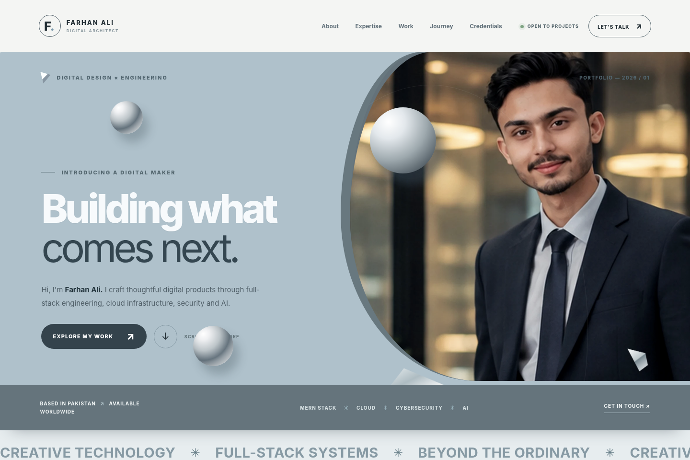
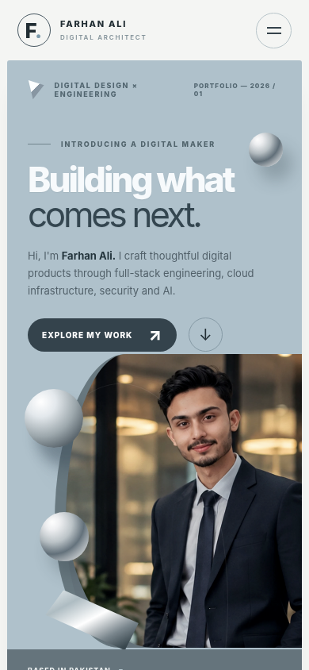
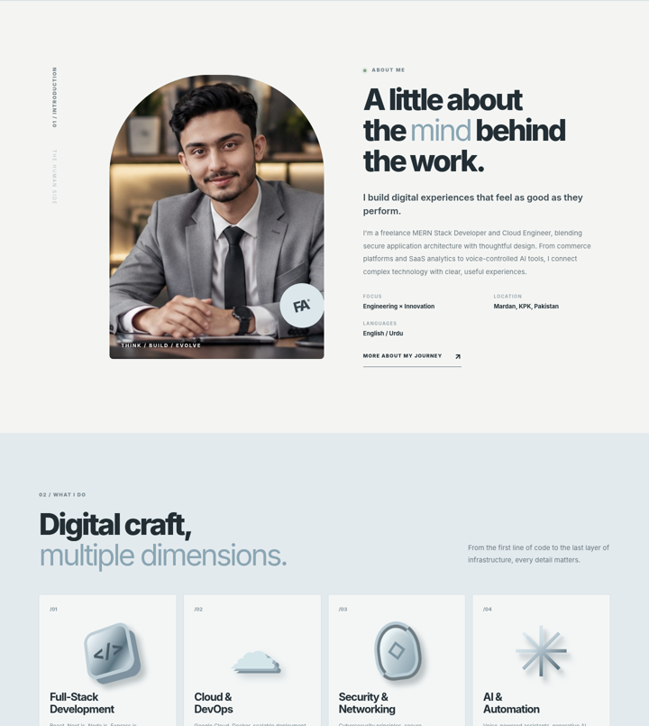

<!--
  FARHAN ALI — STUDIO 3D PORTFOLIO
  The image at the top is an actual Chromium capture included in this repository.
  Keep README.md at the repository root so GitHub displays it automatically.
-->

<div align="center">
  <a href="./previews/desktop-full.png" title="View the complete desktop screenshot">
    
  </a>

  <h1>FARHAN ALI <sub> / STUDIO 3D</sub></h1>

  <p><strong>Building what comes next.</strong></p>
  <p>An immersive, editorial portfolio for a full-stack developer working across cloud engineering, cybersecurity and AI.</p>

  <p>
    
    
    
    
    
  </p>

  <p>
    <a href="#-the-experience">The experience</a> ·
    <a href="#-featured-work">Featured work</a> ·
    <a href="#-run-locally">Run locally</a> ·
    <a href="#-deploy-to-github-pages">Deploy</a> ·
    <a href="#-connect">Contact</a>
  </p>
</div>

---

## ✦ The experience

A portfolio built to feel like a **digital design studio**, not a standard résumé page. The design is inspired by the supplied *3D Modeling Trial* banner's sculptural aesthetic: **misty steel blue, satin silver, deep graphite, monumental typography and architectural portrait framing**.

- **Dimensional hero:** a procedurally generated, animated WebGL icosahedron with a decorative CSS fallback when WebGL is unavailable.
- **Seven cinematic portraits:** locally stored, optimized WebP images used across the experience.
- **Responsive layouts:** a considered composition for both wide screens and narrow mobile displays.
- **Scroll storytelling:** subtle reveals, layered surfaces, progress indicator and section transitions.
- **Useful interactions:** anchor navigation, mobile menu, email, phone, GitHub and LinkedIn links.
- **Accessible defaults:** semantic landmarks, skip link, descriptive image text and reduced-motion handling.
- **Zero-install preview:** the website runs directly from `index.html` — no npm, Node.js, framework or API keys.

## ◇ Screenshots — real browser captures

These images come from Chromium rendering the site's HTML, CSS, JavaScript and local assets. **They are not AI-generated mockups.** The capture environment did not provide GPU WebGL, so the decorative fallback appears in the screenshots; the WebGL-specific runtime still requires verification on a WebGL-capable device.

| Desktop | Mobile |
| :---: | :---: |
| [](./previews/desktop-full.png) | [](./previews/mobile-full.png) |
| [Open full-length desktop screenshot](./previews/desktop-full.png) | [Open full-length mobile screenshot](./previews/mobile-full.png) |

<details>
<summary><strong>See more of the website</strong></summary>

<br />



</details>

## ⬡ Featured work

| Project | Scope | Technologies |
| --- | --- | --- |
| **Commerce, Reimagined** | Full-stack online commerce, payment flows and a management dashboard | Next.js, MongoDB |
| **Insight, in Motion** | SaaS analytics, customer records, private access, subscriptions and CSV exports | React, Node.js, Analytics |
| **Intelligence, Spoken** | Voice assistant integrating speech recognition and generative AI | Python, Speech AI |
| **Made for the Cloud** | A Go application containerized using Docker and deployed to Google Cloud | Go, Docker, Google Cloud |

> Project descriptions are based on Farhan's résumé. Individual source repositories and live project URLs have not been supplied, so none are invented here.

## ◈ What's inside

The portfolio presents Farhan's work and background through **Home, About, Expertise, Projects, Experience, Certifications and Contact** sections. It covers MERN development, cloud architecture, secure engineering, networking, Python and AI, along with professional learning credentials.

### Technology

```text
HTML5             → semantic page structure
CSS3              → responsive layout, layered visuals, custom animations
JavaScript        → navigation, interaction, progress, and WebGL scene
WebGL             → shader-based geometric rendering when supported
WebP              → optimized photography
GitHub Pages      → optional static hosting
```

**This project uses no runtime packages, CDNs or external APIs.** All essential page assets are included in the repository. The README status badges load from Shields.io on GitHub; they are not required to run the site.

## ⚡ Run locally

**Fastest way — no installation**

1. Download the repository ZIP using GitHub's **Code → Download ZIP** (or clone it).
2. Extract the ZIP.
3. Open **`index.html`** in Chrome, Edge, Firefox or Safari.

On Windows, you can also double-click **`OPEN_WEBSITE_WINDOWS.bat`**.

**Optional — serve on localhost**

```bash
# Run this inside the folder containing index.html
python -m http.server 8000
```

Then visit **http://localhost:8000**.

> **No `npm install` and no `npm run dev`.** The earlier Next.js dependency-download problem does not apply to this static implementation.

## 🚀 Deploy to GitHub Pages

1. Create a GitHub repository, e.g. `farhan-portfolio`.
2. Copy **the contents of this folder** into the repository root. Keep `index.html`, `styles.css`, `app.js`, `README.md` and `assets/` together at the top level. Do not upload only the outer ZIP or an enclosing folder.
3. Push the code to the `main` branch.
4. Open **Settings → Pages → Build and deployment**.
5. Choose **Deploy from a branch**, select `main` and `/ (root)`, then save.
6. When GitHub reports deployment, open the Pages URL it provides.

The site uses relative asset paths, so it can be hosted from a project-repository subpath. **A public live-demo URL is not provided here because the website has not been deployed on behalf of the owner.**

## 📁 Project structure

```text
.
├── index.html                  # All portfolio sections and content
├── styles.css                  # Visual system, layouts and motion
├── app.js                      # Interactions and procedural WebGL
├── OPEN_WEBSITE_WINDOWS.bat    # Windows quick-open shortcut
├── README.md                   # This GitHub landing page
├── QA_REPORT.md                # Test results and known limitations
├── assets/
│   ├── favicon.svg
│   ├── images/                   # Seven local WebP portraits
│   └── reference/                # Original visual inspiration banner
└── previews/
    ├── desktop-home.png         # Homepage capture
    ├── desktop-full.png         # Full-page desktop capture
    ├── mobile-home.png          # Mobile capture
    ├── mobile-full.png          # Full-page mobile capture
    └── desktop-sections-preview.png
```

## 🧪 Quality & compatibility

| Check | Status |
| --- | --- |
| JavaScript syntax | ✅ Checked |
| Local images and internal section links | ✅ Checked |
| Responsive layout at 320–1920 px | ✅ Browser-checked |
| Mobile navigation | ✅ Browser-checked |
| Desktop and mobile browser screenshots | ✅ Captured |
| Dependencies / npm installation | ✅ Not required |
| Procedural WebGL rendering on a real GPU | ⚠️ Not verified in the available test environment |
| GitHub Pages live deployment | ⚪ Not deployed yet |

Read [**QA_REPORT.md**](./QA_REPORT.md) for exact test scope and caveats. This README does not claim every browser and device is error-free.

## 🎨 Inspiration & attribution

The site is an **original HTML/CSS/JavaScript implementation**, visually inspired by a user-supplied *3D Modeling Trial* JPG/PSD graphic. That artwork is a **static design reference, not an exported website or reusable interactive template**. The reference JPG is retained in `assets/reference/` for private design comparison; check the original artwork's license before public redistribution.

Portraits and professional details are supplied for this portfolio; please obtain the rights to any substituted assets before reuse.

## ✉ Connect

<div align="center">

**Farhan Ali** · Full-Stack Developer · Cloud Engineer · Security & AI Enthusiast

[**GitHub**](https://github.com/FARHANALi-DEve) · [**LinkedIn**](https://www.linkedin.com/in/farhan-ali-985901241/) · [**Email**](mailto:farhan2545426@gmail.com)

<br />

**Crafted to stand out. Engineered to work.**

<sub>© 2026 Farhan Ali · Designed and developed for the Farhan Ali portfolio.</sub>

</div>
